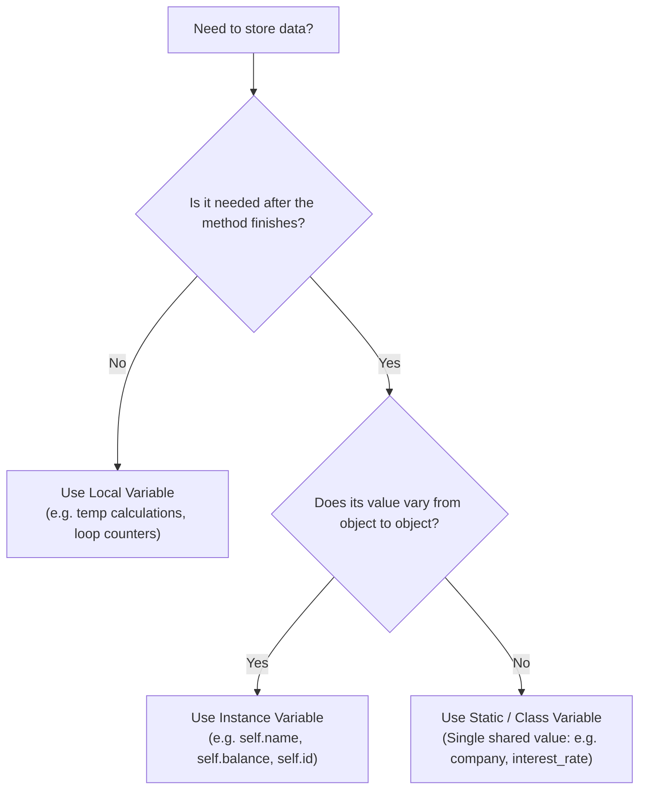

# Types of Variables in Python OOP & When to Use a Single Shared Value

## 1. Definition
Python Object-Oriented Programming defines **three distinct types of variables** based on where they are declared, who owns them, and how long they live in memory:

1. **Instance Variables (Object-Level):** Variables tied to an individual object. Each object maintains its own independent copy.
2. **Static / Class Variables (Class-Level):** Variables declared directly inside the class body. Only **one single copy** is created in memory and shared across **all** instances of that class.
3. **Local Variables (Method-Level):** Variables created temporarily inside a method. They exist only while the method executes and are automatically destroyed when the method returns.

---

## 2. When to Use Only a Single Shared Value (Static Variable)

A common beginner question is: *"Why not just store everything inside each object using `self`?"*

### Real-World Example:
Consider a bank with **100,000 customers**:
- **Customer Name & Account Number:** Must be unique for every customer -> **Instance Variable**.
- **Bank Name (`"State Bank of India"`), IFSC Code, Branch Address, Interest Rate (`4.5%`):** Exactly identical for all 100,000 customers.

### 2 Big Reasons to Use a Single Shared Value:

#### 1. Massive Memory Optimization (RAM Savings)
- If we store `self.bank_name = "State Bank of India"` in each instance, Python creates 100,000 individual dictionary entries in memory.
- If we declare `bank_name = "State Bank of India"` once at the class level, Python stores **only 1 single copy in RAM**. All 100,000 objects reference that single address.

#### 2. Guaranteed Data Consistency (Instant Synchronization)
- If the RBI changes the interest rate from `4.5%` to `5.0%`:
  - With instance variables, you would have to loop through 100,000 objects and update each one individually.
  - With a static class variable, changing **one line** (`Bank.interest_rate = 5.0`) instantly updates the rate for all 100,000 customers at once!

---

## 3. Comparison of the 3 Types of Variables

| Feature | Instance Variable | Static / Class Variable | Local Variable |
| :--- | :--- | :--- | :--- |
| **Where Declared** | Inside `__init__` / methods using `self.` or outside using `obj.` | Inside class body, outside all methods | Inside a method without `self.` |
| **How Many Copies?** | One copy per object | **Only one single copy** shared by all | Created on call, destroyed on return |
| **Memory Allocation** | When object is created (`obj = Class()`) | When class is loaded by Python interpreter | When method is called |
| **Memory Deallocation** | When object is deleted (`del obj` or garbage collected) | When program/module terminates | When method execution finishes |
| **Access Syntax** | `self.var` or `obj.var` | `ClassName.var` or `cls.var` | By plain variable name `var` inside method |

---

## 4. Syntax & Declaration Places

```python
class Student:
    # 1. Static / Class Variable (Single shared value)
    college = "National College"

    def __init__(self, roll_no, name):
        # 2. Instance Variables (Unique per student)
        self.roll_no = roll_no
        self.name = name

    def compute_marks(self, physics, chemistry, maths):
        # 3. Local Variables (Temporary, used only for computation)
        total = physics + chemistry + maths
        percentage = (total / 300) * 100
        return percentage
```

---

## 5. Decision Guide: Which Variable Type Should I Use?



---

## 6. Practical Example: Complete Lifecycle

```python
class Car:
    wheels = 4  # Static variable (shared across all cars)

    def __init__(self, brand, color):
        self.brand = brand  # Instance variable
        self.color = color  # Instance variable

    def calculate_road_tax(self, base_price):
        tax_rate = 0.12     # Local variable
        total_tax = base_price * tax_rate  # Local variable
        return total_tax
```

---

## 7. Common Mistakes
1. **Using instance variables for shared constants:**
   Storing `self.company_name = "TCS"` inside `__init__` wastes memory when thousands of employees belong to the same company.
2. **Attempting to access local variables outside the method:**
   ```python
   # ❌ AttributeError: 'Car' object has no attribute 'tax_rate'
   my_car = Car("Honda", "White")
   print(my_car.tax_rate)
   ```
   Local variables exist only on the call stack during method execution.
3. **Accidental Attribute Shadowing:**
   Writing `obj.wheels = 6` creates an instance variable `wheels` on `obj`, leaving the class variable `Car.wheels` unchanged.

---

## 8. Quick Revision Notes
- **Static Variable:** 1 shared value across all instances. Declared in class body. Access via `ClassName.var`.
- **Instance Variable:** Separate value per instance. Declared using `self.var`. Access via `self.var` or `obj.var`.
- **Local Variable:** Temporary value inside method. Declared without `self`. Exists only during method call.

---

## 9. Real-World Scenarios
- **E-Commerce Order:**
  - `Order.platform_fee = 5` (Static - same for all orders)
  - `self.order_id`, `self.items` (Instance - unique per order)
  - `discount_amount = price * 0.10` (Local - temporary calculation)
- **School Portal:**
  - `School.school_name = "Delhi Public School"` (Static)
  - `self.student_name`, `self.roll_no` (Instance)
  - `final_grade = "A+"` (Local)

---

## 10. Practice Questions & Answers

### Q1: When is memory allocated for a static variable vs an instance variable?
**Answer:** Memory for a static variable is allocated **once** when the class definition is loaded by Python. Memory for instance variables is allocated **each time a new object is created** (`__init__`).

### Q2: Can a local variable have the same name as an instance variable in the same method?
**Answer:** Yes. For example:
```python
def update(self, name):
    name = "Temp"      # Local variable
    self.name = name   # Assigns local variable to instance variable
```
Python distinguishes between them because the instance variable is prefixed with `self.`.

### Q3: Why is a single shared value preferred for tracking total objects created?
**Answer:** Because an instance variable is reset for each new object. A static variable (`ClassName.count += 1`) persists across all instances, allowing an accurate cumulative count.

### Q4: What happens to a local variable after a method returns?
**Answer:** The local variable's stack frame is popped, its reference count drops to zero, and Python's garbage collector immediately frees its memory.

### Q5: Identify the types of variables in the following code:
```python
class Circle:
    pi = 3.14159

    def __init__(self, radius):
        self.radius = radius

    def area(self):
        result = Circle.pi * (self.radius ** 2)
        return result
```
**Answer:**
- `pi`: Static / Class variable (single shared constant).
- `self.radius`: Instance variable (unique per circle).
- `result`: Local variable (temporary calculation variable).
